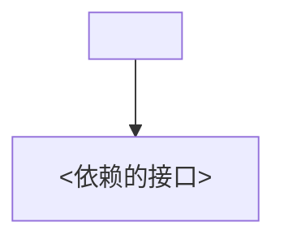

# Module Contract

把一个新功能需求模块化，产出**接口卡**与**模块汇总地图**，并在动工前做**复用分析**。本 skill 只做设计，不写实现——实现交给其它流程。

模块分两级（**结构轴**）：**原子模块**与**复合模块**；处置走**决策轴**四分类（直接复用 / 换 adapter / 扩展 / 新建）。

词汇采用 **codebase-design** 的深模块词汇，术语定义以其为准。本 skill 补充三个结构词，其余保留最小集：

- **Atomic module（原子模块）**（本 skill 补充）：不依赖其它项目模块接口的结构单元；下限由删测守，可深（接口窄、行为多）。
- **Composite module（复合模块）**（本 skill 补充）：依赖其它模块接口、由原子/复合组合而成的模块；在依赖图里有出边。
- **复合删测**（本 skill 补充）：删掉一个命名复合，它的编排顺序 / 前后置约束会散到 ≥2 个调用方吗？会 → 命名；只有 1 处 → 不命名，留作编排代码。
- **Module**：有接口和实现的任意粒度（函数 / 类 / 包 / 跨层切片）。
- **Interface**：调用方要用对模块必须知道的一切：类型签名，外加不变量、顺序约束、错误模式、配置、性能特征。
- **Seam**：接口所在的、可替换行为的位置。
- **Adapter**：在 seam 处满足某个接口的具体实现（扮演角色，不是内部是什么）。
- **Depth / leverage**：每学一单位接口能驱动多少行为；接口越窄而行为越多，越深。
- **Deletion test**：想象删掉模块——复杂度消失则是穿通，散布到 N 个调用方则值得留下。

## 过程

### 1. 定位项目根与既有知识

- 项目根 = 当前仓库（cwd）。此后所有路径相对它。
- 读 `docs/modules/MODULE-MAP.md`；缺席则先按下方模板**引导建骨架**（首次运行）。
- 有 `CONTEXT.md` 就读它取领域词；否则退回通用词。领域词一律来自当前项目，绝不写死某个项目术语。

**完成**：根已定位；MODULE-MAP 已读或已建骨架。

### 2. 读懂新需求

- 从上下文把握这次要加的功能，明确它要满足的行为边界。

**完成**：能一句话复述这个功能要什么。

### 3. 模块化

- 识别**高内聚**的能力，切成候选**原子模块**，逐个过判据：
  - **Deletion test**：删掉它，复杂度是消失还是散布到多处？消失则砍掉，散布则留下。
  - **窄接口**：方法少、参数简单，把复杂性藏在内部。
  - **可深**：原子不等于小/浅；优先产出接口窄、行为多的深原子，别拆成一堆浅原子。
- 原子之间依赖**接口 / seam**，组合成**复合模块**；依赖的是接口，不是具体实现。
- 复合模块过**复合删测**：编排顺序/约束会散到 ≥2 个调用方才命名，否则只写编排代码、不落地图。
- 数据流只作辅助线索，不作切分主判据。

**完成**：每个候选原子都过了删测并明确 seam；复合是否命名过了复合删测。

### 4. 复用分析（决策阶梯）

提出新功能后，先做复用分析，按以下阶梯从**低破坏性到高**逐档判断，每档都记录判断与理由：

1. **直接复用**——现有原子/复合（按“组合后接口 + 一句话职责”匹配）已覆盖需求。
2. **复合重组（组合优先）**——不加新原子、不改现有模块，用现有原子拼出所需能力；过**复合删测**则命名新复合，否则只写编排代码。仅当现有原子能自然拼出、不勉强时采用；拼得勉强或无独立职责，快速落到下一档，不硬凑。
3. **换 adapter**——同一 seam 换一个满足接口的实现（真 seam 才换；只有一个实现时先当作假设 seam）。
4. **扩展**——在同一接口上补行为；扩展后**重走删测**，若把原子撑胖则拆新原子。
5. **最少新增原子**——前四档都不行，圈出“现有原子拼不出的能力块”，切成**最小数量**的新原子（每个过删测 + 原子下限），并**立即**组进某个复合；禁止无主新原子，对称不是加原子的理由。

- 检索依据：在 MODULE-MAP 与代码中按名称、职责、输入输出检索；对复合按“顶层职责”匹配，不看内部怎么拼。
- 落档记录：最终归入决策轴四分类 **直接复用 / 换 adapter / 扩展 / 新建** 之一，并写明理由；拿不准的标 `⚠` 走保鲜核对，宁多问不臆断。

**完成**：每个模块都走完阶梯、落入四分类之一，且各有理由；先确认组合（拼凑）能否覆盖需求，不能才新建原子。

### 5. 决策模式

- 读 MODULE-MAP.md 头部 `复用决策模式: confirm | auto`。
- `confirm`：把“模块列表 + 接口卡草案 + 复用建议”给你确认，批准后才写卡。
- `auto`：直接写卡。
- **这一个开关同时管两件事**：模块切分方案的确认 + 复用决策的确认。

**完成**：mode 已读；confirm 模式等你批准，或 auto 模式下直接进入写卡。

### 6. 写接口卡

每个模块一个文件 `docs/modules/<slug>.md`，用下方**接口卡模板**（10 栏）。模块 ID 用简短 slug。不加“类型”栏：`依赖模块` 为空即原子，非空即复合，依赖图已表达这层关系。

**完成**：每个新模块都有一张完整的卡，栏栏有值。

### 7. 更新 MODULE-MAP.md

- MODULE-MAP.md 头部保留 `复用决策模式` 行。
- 每个模块一行摘要（ID / 职责 / 状态 / 依赖），并维护 Mermaid **依赖图**。

**完成**：每个新模块在地图里都有一行，依赖关系进入依赖图，模式行未丢。

### 8. 保鲜核对

- 尽量把接口卡与代码 / 类型对照；凡能从代码核对的事实，去核对。
- 对不上或读不出真实代码的字段，标 **`⚠ 待核对`**。
- 模块被改 / 弃用时，同步更新对应接口卡与地图。

**完成**：能核对的事实已核对，核对不了的在卡上标 `⚠ 待核对`。

## 接口卡模板

```markdown
# <slug>

**一句话职责：** <职责>

## 接口
- 暴露给调用方的签名 / 行为
- 不变量 / 顺序约束 / 错误模式

## 输入
- 参数与类型
- **前置条件**：调用前必须满足什么

## 输出
- 返回结构
- **后置条件**：返回后保证什么

## 依赖模块
- 依赖的是接口 / seam，不是具体实现

## 副作用 / 外部资源
- DB / 文件 / 网络 / 时钟 / 随机数

## 非功能
- 超时 / 并发 / 幂等 / 性能

## 深度评估
- 接口够窄吗？删掉它复杂度去哪？（删除测试）
- 复合模块：过复合删测了吗（编排约束会散到 ≥2 处）？原子模块：够原子、可组合吗？
- 一句自检结论

## 复用状态
- planned | implemented | reusable | deprecated
```

## MODULE-MAP.md 模板

```markdown
# Module Map

复用决策模式: confirm | auto

## 模块

| ID | 职责 | 状态 | 依赖 |
|---|---|---|---|
| <slug> | <职责> | planned | <依赖接口名> |

## 依赖图


```
