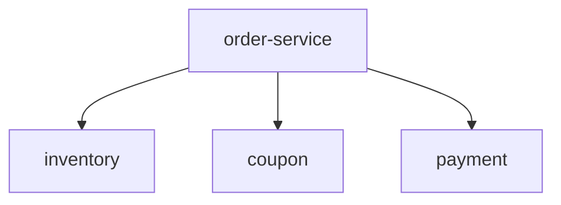

# Module Map

> `module-contract` 维护的**模块汇总地图**示例：每模块一行摘要 + 依赖图，动工前据此走决策阶梯做复用分析。

复用决策模式: confirm | auto

## 模块

| ID | 职责 | 状态 | 依赖 |
|---|---|---|---|
| `order-service` | 校验并创建订单 | implemented | inventory, coupon, payment |
| `inventory` | 库存查询与扣减 | implemented | — |
| `coupon` | 优惠券报价 | **reusable** | — |
| `payment` | 创建支付单 | implemented | — |

## 依赖图

> 依赖图即结构轴：**有出边 = 复合模块**（`order-service`），**无出边 = 原子模块**（`inventory` / `coupon` / `payment`）。

## 复用分析示例（本次新增功能：结算）

- `coupon` 已满足“优惠报价”接口 → **直接复用**。
- `inventory` 在环境里只有一个实现 → 暂视为**假设 seam**，按需再引入 adapter（**换 adapter**）。
- 无现成模块满足“下单”，且现有原子拼不出 → **新建**复合 `order-service`（内部组合 `inventory`/`coupon`/`payment`）。

> 说明：`confirm` 模式下，`order-service` 的接口卡草案与上述复用建议都会先提交给你确认，你批准后才落卡。
