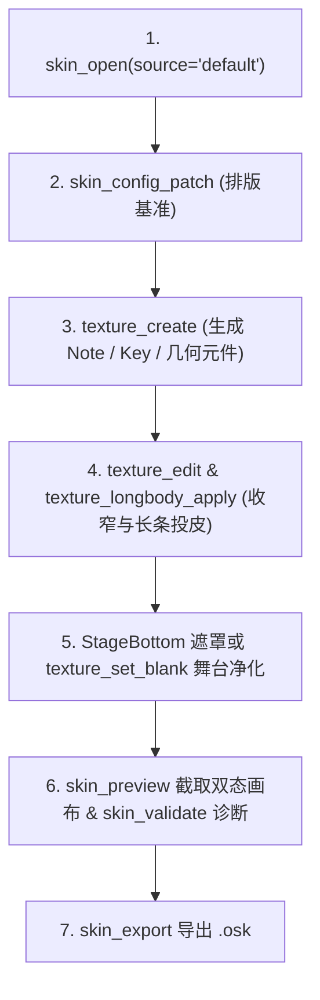

# osu!mania Skin Craft & Style Guide

本 Skill 沉淀了使用 `osu-mania-skin-agent` MCP 工具链制作专业级 osu!mania 皮肤的核心心法、流派风格与参数化配方库。融合了主流高难度与锦标赛顶尖玩家皮肤（如 Tekkito、Bojii、Eliminate、R-Skin 等）的设计精髓，提供从默认皮肤到发布级 `.osk` 的全流程装配指导。

---

## 一、 底层核心心法与机制法则

在调用 MCP 工具操作皮肤前，必须掌握以下 osu!stable 引擎与编辑器的底层渲染规律：

### 1. 480p 缩放基准与宽高对齐
* **渲染基准**：Mania 演奏区大部分坐标与尺寸基于 **480p 垂直基准**（`scale48 = CanvasHeight / 480`），`@2x` 高清贴图在读取时会自动折半对齐 1x 规格。
* **横向拉伸约束**：osu!mania 会强制将贴图横向拉伸/压缩至所在轨道的 `ColumnWidth`。
  * **正圆守则**：如果制作球皮，贴图内容宽度必须 100% 对应轨道有效宽度，或通过正方形宽高比保持 1:1，否则球体会变形为扁椭圆。

### 2. 贴图图层层级（Render Hierarchy）
从上层到下层（上层会遮挡下层）：
1. **`StageBottom`（舞台底栏）**：最顶层覆盖，绘制在音符与按键之上。
2. **`KeyImage` / `NoteImage`**：受 `KeysUnderNotes` 调控：
   * `KeysUnderNotes: 0`（默认）：按键在音符上方（Note 滚入按键下方）。
   * `KeysUnderNotes: 1`（职业推荐）：按键在音符下方（Note 盖在按键上方，读谱击打更清晰）。
3. **`LightingN` / `LightingL`**：打击爆发光效与长条持续光效。
4. **`StageHint`（判定线贴图）**：绘制在音符下方，仅作为打击基准参照。
5. **`StageLight`（按键光柱）**：背景层按键常态打光。

### 3. 事务与版本控制
* 所有写工具均需要传入 `expectedRevision`，写操作会自动产生一次可撤回事务（支持 `skin_undo` 与 `skin_redo`）。
* 多轨贴图推荐优先采用单次批处理生成或联动修改。

---

## 二、 常见皮肤流派风格归纳（来自真实样本库）

根据 `samples/skins` 中收录的职业与知名皮肤归纳，osu!mania 主要流行以下四大风格流派：

| 风格流派 | 代表皮肤样本 | 核心视觉特征 | 适用场景 |
|---|---|---|---|
| **极简球皮 (Circle / Orb)** | `R Skin (Rin O)`, `bojii`, `Scattered` | 1:1 正圆形音符、空心环/实心光球按键、收窄圆头长条 | 全能通用、高密度谱面、LN 控制 |
| **四向踏板箭头 (Arrow / StepMania)** | `# - tekkito2`, `Eliminate294`, `Gyoo`, `sk` | 经典左/下/上/右方向箭头、镂空箭头底座、尖头长条 | 读谱方向感强、传统 VSRG 玩家 |
| **竞技方块条皮 (Bar / Pill)** | `R Skin (Bars_Circle)`, `Kumakalerki`, `pl0x&chordxx` | 纯色横条/微圆角胶囊块（高 12~24px）、超轻量无装饰 | Chordjack、极速切键、高 BPM 底力 |
| **锦标赛纯净流 (Tournament Clean)** | `Eliminate294`, `layin'`, `pl0x&chordxx` | 彻底屏蔽所有打击特效、按键打光与判定线，连击数偏置避让 | 比赛竞技、抗视觉疲劳、帧率最大化 |

---

## 三、 标准配方库（Recipe Book）

### 配方 1：经典极简球皮（Circle / Orb Skin）

#### 1. 轨道与基础配置 (`skin_config_patch`)
```json
{
  "parameters": [
    { "key": "ColumnWidth", "value": "64,64,64,64" },
    { "key": "HitPosition", "value": 440 },
    { "key": "KeysUnderNotes", "value": 1 },
    { "key": "JudgementLine", "value": 0 }
  ]
}
```

#### 2. 单键与长条头（NoteImage & HoldNoteHead）
使用 `texture_create` 生成高反差双色球（以 4K 对称蓝白为例）：
* **1/4 轨（外轨蓝球）**：
  * `paramKey`: `NoteImage0`（及 `NoteImage3`, `HoldNoteHeadImage0`, `HoldNoteHeadImage3`）
  * `shape`: `circle`, `width`: 64, `height`: 64
  * `color`: `#3498db`, `strokeEnabled`: true, `strokeColor`: `#000000`, `strokeWidth`: 2
* **2/3 轨（内轨白球）**：
  * `paramKey`: `NoteImage1`（及 `NoteImage2`, `HoldNoteHeadImage1`, `HoldNoteHeadImage2`）
  * `shape`: `circle`, `width`: 64, `height`: 64
  * `color`: `#ffffff`, `strokeEnabled`: true, `strokeColor`: `#000000`, `strokeWidth`: 2

#### 3. 虚实互动按键（KeyImage / KeyImageD）
* **常态按键（空心环）**：
  * `paramKey`: `KeyImage0~3`, `shape`: `circle`, `width`: 64, `height`: 64
  * `alpha`: 0, `strokeEnabled`: true, `strokeColor`: `#888888`, `strokeWidth`: 3
* **按下态按键（高亮发光实心球）**：
  * `paramKey`: `KeyImage0D~3D`, `shape`: `circle`, `width`: 64, `height`: 64
  * `color`: `#3498db` / `#ffffff`, `alpha`: 90, `strokeEnabled`: true, `strokeColor`: `#ffffff`, `strokeWidth`: 2

---

### 配方 2：四向箭头踏板皮（Arrow / DDR Style）

适用于喜欢传统 StepMania / Dance Dance Revolution 读谱体验的玩家。

#### 1. 基础配置
```json
{
  "parameters": [
    { "key": "ColumnWidth", "value": "72,72,72,72" },
    { "key": "HitPosition", "value": 460 },
    { "key": "KeysUnderNotes", "value": 0 },
    { "key": "JudgementLine", "value": 0 }
  ]
}
```

#### 2. 生成四向箭头贴图 (`texture_create`)
对应 0 轨（左）、1 轨（下）、2 轨（上）、3 轨（右）：
* **单键音符**：
  * 0 轨：`paramKey`: `NoteImage0`, `shape`: `arrow-left`, `width`: 72, `height`: 72, `color`: `#e74c3c`, `arrowThickness`: 22, `arrowRoundness`: 50
  * 1 轨：`paramKey`: `NoteImage1`, `shape`: `arrow-down`, `width`: 72, `height`: 72, `color`: `#3498db`, `arrowThickness`: 22, `arrowRoundness`: 50
  * 2 轨：`paramKey`: `NoteImage2`, `shape`: `arrow-up`, `width`: 72, `height`: 72, `color`: `#3498db`, `arrowThickness`: 22, `arrowRoundness`: 50
  * 3 轨：`paramKey`: `NoteImage3`, `shape`: `arrow-right`, `width`: 72, `height`: 72, `color`: `#e74c3c`, `arrowThickness`: 22, `arrowRoundness`: 50
* **按键底座（Receptor）**：
  * 常态：中空箭头或浅灰半透箭头（`alpha`: 30, `strokeEnabled`: true, `strokeColor`: `#aaaaaa`）；
  * 按下态：高亮白色实心箭头（`color`: `#ffffff`, `alpha`: 100）。
* **长条身体与尖尾**：
  * 投皮长条时尾部预设选择 `tailPreset: 'sharp'`（尖头尾部），完美匹配箭头方向性。

---

### 配方 3：高可读性长条投皮（Narrow Percy LN）

> **职业法则**：长条身体如果 100% 占满轨道，在相邻双押长条（LN Wall）时会连成大片色块引发读谱灾难。长条身必须收窄至轨道的 70%~80%，并保持长条头为饱满原宽。

#### 第 1 步：长条身贴图左右透明扩边 (`texture_edit`)
若轨道宽 64px，让身体主体为 48px，需在左右各垫 8px 全透明外边距：
```json
{
  "paramKey": "HoldNoteBodyImage0",
  "crop": {
    "left": 8,
    "right": 8,
    "top": 0,
    "bottom": 0
  },
  "mode": "overwrite"
}
```

#### 第 2 步：一键投皮合成超长画布 (`texture_longbody_apply`)
利用投皮合成器自带的 `getLongBodyBaseContentBounds` 自动边界识别：
```json
{
  "column": 0,
  "targetHeight": 40000,
  "tailPreset": "round",
  "presetHeight": 48,
  "fade": 25,
  "scope": "all"
}
```
* **效果**：长条尾部圆弧自动收缩并居中对齐收窄后的身体主体；顶部 25% 带有平滑渐隐，防止高密度长条遮挡上方掉落的单键。

#### 第 3 步：隐藏原生尾巴贴图 (`texture_set_blank`)
```json
{
  "paramKey": "HoldNoteTailImage0",
  "scope": "all"
}
```
* 避免默认皮肤自带的长条尾盖在投皮之上造成贴图冲突。

---

### 配方 4：SUDDEN+ 舞台上隐遮罩（Lane Cover）

> **黑科技原理**：osu!stable 没有 Mania 专用的 SUDDEN+ 参数，但 `StageBottom` 的图层绘制在音符与长条之上，且底部严格贴齐屏幕底端（480p 画布高）。通过制作“上半部实体黑块 + 下半部纯透明”的高 480px 贴图，即可将屏幕上方区域完全吃掉，实现视线遮罩。

#### 第 1 步：生成遮罩顶板与标尺线 (`texture_create`)
假设 4K 轨道总宽 256px，需要遮挡屏幕上方约 35%（高 170px），并带白色下沿刻度线：
```json
{
  "paramKey": "StageBottom",
  "shape": "rectangle",
  "width": 256,
  "height": 170,
  "color": "#000000",
  "alpha": 100,
  "strokeEnabled": true,
  "strokeColor": "#ffffff",
  "strokeWidth": 2
}
```

#### 第 2 步：向下透明扩边撑满 480p 高度 (`texture_edit`)
下半部所需透明高度：`480 - 170 = 310px`：
```json
{
  "paramKey": "StageBottom",
  "crop": {
    "left": 0,
    "right": 0,
    "top": 0,
    "bottom": 310
  },
  "mode": "overwrite"
}
```
* **效果**：整张图变为 256×480。贴底加载后，上部 170px 实心黑块刚好稳稳盖在轨道上方，落下的音符只有下落到 170px 以下才会突然显形！
* **倒落模式例外**：若 `UpsideDown: 1`（倒落），音符从底部往上飞，直接创建 `height: 170` 的矩形赋给 `StageBottom` 即可，天然贴底遮挡生成点。

---

### 配方 5：锦标赛纯净竞技净化（Tournament Noise Purge）

彻底消除视觉光污染，将眼睛精力 100% 集中在音符判定点上：

```json
// 1. 屏蔽多余贴图
texture_set_blank({ "paramKey": "StageHint" })
texture_set_blank({ "paramKey": "StageLight" })
texture_set_blank({ "paramKey": "LightingN" })
texture_set_blank({ "paramKey": "LightingL" })

// 2. 规避连击数遮挡并去除多余白线
skin_config_patch({
  "parameters": [
    { "key": "JudgementLine", "value": 0 },
    { "key": "ComboPosition", "value": 110 }
  ]
})
```

---

## 四、 完整制作与装配质检工作流

当用户提出皮肤设计需求时，严格遵循以下 7 步标准流水线执行：



1. **建立基底**：调用 `skin_open({ source: 'default', keyCount: 4, confirmReset: true })`。
2. **基准参数**：根据目标流派使用 `skin_config_patch` 确立 `ColumnWidth`、`HitPosition`、`KeysUnderNotes`。
3. **音符与按键装配**：调用 `texture_create` 批量生成 Note 与 KeyImage 贴图。
4. **长条处理**：对身体贴图执行左右 `crop` 透明扩边，随后调用 `texture_longbody_apply` 投皮，并将尾巴 `texture_set_blank`。
5. **遮罩与净化**：如果需要上隐，按公式配置 `StageBottom`；用 `texture_set_blank` 移除多余默认组件。
6. **视觉与结构质检**：
   * 调用 `skin_preview({ state: 'idle' })` 检查静止判定区与舞台布局；
   * 调用 `skin_preview({ state: 'hold' })` 检查长条按住状态与发光反馈；
   * 调用 `skin_validate` 确保无缺失或异常大尺寸贴图。
7. **交付落盘**：调用 `skin_export({ outputPath: '...', format: 'osk', mode: 'editable' })` 导出皮肤包。
