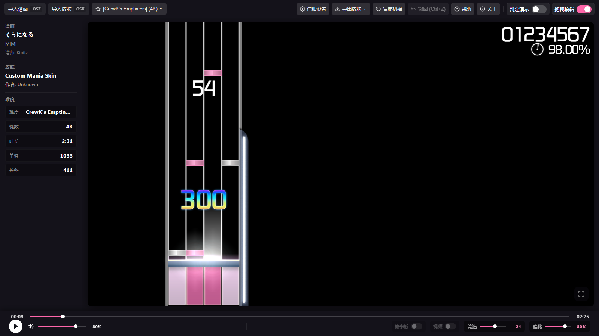

# osu!mania Skin Editor

本地运行的 osu!mania 皮肤可视化编辑器，主要用于预览、修改并导出 osu!stable 兼容的 `skin.ini` 与贴图资源。

## 声明

本项目完全通过 vibe coding 制作：代码、文档与资源均由 AI 辅助生成并持续迭代，甚至连上传GitHub也是通过agent完成的，作者本人完全业余。

## 效果图

> 截图使用内置默认皮肤，未包含第三方皮肤贴图或谱面曲绘。

### 编辑器主界面

导入谱面后即可实时预览 osu!stable 风格的 mania 轨道、音符、长条与判定 HUD。



### skin.ini 可视化参数

按 `[Mania]` 键位读取配置

## 启动

需要 Node.js；浏览器建议使用本机 Chrome。

```powershell
npm install
npm run serve
```

然后访问：

```text
http://127.0.0.1:8765/
```

也可以直接以桌面窗口启动：

```powershell
npm install
npm run desktop
```

## 打包 Windows exe

```powershell
npm install
npm run dist:win
```

生成的便携版程序位于 `dist/osu-mania-skin-editor-0.2.0-x64.exe`，无需安装，双击即可运行。

## 部署到 Cloudflare Pages

首次使用需要完成 Wrangler 登录：

```powershell
npx --yes wrangler@4.149.0 login
```

生成静态站点并发布到 `osu-mania-skin-editor` Pages 项目的生产分支：

```powershell
npm run deploy:pages
```

静态发布产物位于 `site/`，只包含浏览器运行需要的页面、脚本、皮肤资源和许可证文件，不包含 Electron、FFmpeg 或测试文件。

## 常用命令

```powershell
npm run check
npm run test:e2e
```

`npm run check` 对运行时 JavaScript 做语法检查，并确认 CSS、HTML 构建产物与源码同步。`npm run test:e2e` 使用 Playwright 验证页面加载和关键画布行为。

CSS 源码按领域拆分，运行时使用生成的 `style.css`。修改 `src/css/` 后运行：

```powershell
npm run build:css
```

HTML 页面由模板和片段生成。修改 `src/html/` 后运行：

```powershell
npm run build:html
```

不要再直接修改生成的 `index.html`。`npm run serve` 和 `npm run test:e2e` 会自动先执行构建。

## 目录结构

```text
/
  LICENSE                    # 本项目源码的 MIT 许可
  THIRD_PARTY_NOTICES.md     # 第三方组件、参考项目与素材的许可声明
  index.html                 # 唯一入口
  src/
    html/
      index.template.html    # 页面骨架与片段引用
      partials/              # 顶栏、画布、弹窗、播放器和脚本列表
    css/
      style.css              # 构建生成的 CSS 单文件入口
      README.md              # CSS 模块索引与级联顺序
      tokens.css             # 变量、重置与基础样式
      player.css             # 底部播放器
      shell.css              # 顶栏、侧边栏与主舞台
      skin-editor.css        # skin.ini 编辑器
      canvas-tools.css       # 画布选中与拖拽工具
      texture-editor.css     # 贴图上传与动态贴图编辑器
      help.css               # 帮助弹窗
      cursor.css             # 皮肤光标
    js/
      core/                  # 全局状态、布局与共享常量
      skin/                  # skin.ini 解析、Mania 配置与参数元数据
      parser/                # 谱面、压缩包、贴图和 TimingPoints
      render/                # Canvas 帧、字体、贴图、HUD 与诊断
      ui/                    # 播放器、参数面板、贴图编辑、导出与启动
      cursor.js              # 皮肤光标覆盖层
      default_skin.js        # 官方默认皮肤资源清单
      README.md              # JS 模块索引与加载顺序
  assets/
    default_skin/            # 运行时默认皮肤资源
  vendor/                    # 本地第三方运行库
  docs/
    architecture.md          # 依赖关系和维护说明
    images/                  # README 效果图
    lazer-reference/         # 仅用于 stable 兼容行为对照的源码片段
  tests/e2e/                 # 浏览器端回归测试
  tools/                     # 辅助脚本和工具
  samples/                   # 本地测试皮肤与谱面，不纳入版本控制
```

## 依赖说明

- `jszip` 与 `utif` 已放在 `vendor/`，页面在离线环境仍可使用其本地副本。
- 谱面解析使用本地原生解析器，并支持 `.osu` / `.osb` storyboard、图片动画与 `Video` 背景播放；桌面版可完全离线运行。Chromium 不支持的视频会交给随包附带的 LGPL FFmpeg 转为 VP8/WebM 后播放。
- `samples/` 和 `test-results/` 默认被 `.gitignore` 排除，避免测试素材与生成结果污染源码仓库。

## 版权与许可

- 本项目自身编写的源码以 [MIT License](LICENSE) 授权，版权归 `BJZM` 所有。
- 第三方组件、参考源码与游戏素材的归属见 [THIRD_PARTY_NOTICES.md](THIRD_PARTY_NOTICES.md)。
- `docs/lazer-reference/` 摘录自 [ppy/osu](https://github.com/ppy/osu)，按 MIT 许可使用并保留原始版权头。
- 谱面解析默认使用项目自带的 `parseOsuBeatmap`；storyboard / Video 的 stable 事件解码行为对照了 [kionell/osu-parsers](https://github.com/kionell/osu-parsers)（MIT），代码同时保留可选 `BeatmapDecoder` 入口，但未捆绑该库源码。
- `vendor/` 内的 JSZip 与 UTIF.js 分别按 MIT 许可使用。
- 界面内联 SVG 图标来自 [Feather Icons](https://github.com/feathericons/feather)（MIT）。
- 视频回落转码使用随包附带的 [BtbN FFmpeg Builds](https://github.com/BtbN/FFmpeg-Builds) `n8.1.3-16-ge0a878dd70` Windows x64 LGPL shared 构建，转码输出为 VP8/WebM。组件按 **LGPL-3.0-or-later** 使用，动态库与独立进程均可替换；详见 `vendor/ffmpeg-lgpl-win64/NOTICE.md`。
- `assets/default_skin/` 来自 osu! 官方默认皮肤，版权归 ppy Pty Ltd，**不适用本项目 MIT 许可**，仅限非商业使用；详见 `assets/default_skin/NOTICE.md`。
- osu!、osu!mania 是 ppy Pty Ltd 的商标。本项目为非官方第三方工具，与 ppy Pty Ltd 无隶属或背书关系。

页面顶栏的“关于”按钮会展示版本、许可与上述第三方声明。

## 项目约束

本项目以 osu!stable 行为为目标。涉及 lazer 源码时，只参考 lazer 中用于还原、兼容或对照 stable 的实现，不将 lazer 独有行为作为目标。
