# Module Map

复用决策模式: auto

## 模块

| ID | 职责 | 状态 | 依赖 |
|---|---|---|---|
| texture-rgb-adjustment | 对单张 canvas 按 RGB 通道增益调整颜色，保留透明度 | implemented | 无 |
| texture-solid-shape-factory | 按尺寸、填充 RGBA、可选像素边界描边与形状蒙版生成 canvas | implemented | 无 |
| texture-image-editor | 组合多草稿纯色形状创建、像素边界描边、通用编辑参数、单图覆盖保存、共享引用同步/独立副本决策、KeyImage 分状态参数同步、历史记录与贴图保存流程 | implemented | texture-solid-shape-factory, texture-rgb-adjustment |
| texture-existing-sources | 枚举当前皮肤的已有贴图，支持动画默认去重或逐帧展开、原路径大小写恢复与搜索 | implemented | skin-assets, global-skin-state |
| texture-param-lookup | 将一个贴图参数及其别名统一指向已有贴图路径 | implemented | texture-resolve, global-skin-state |
| texture-existing-picker-view | 渲染已有贴图候选网格、缩略图、规格角标与空状态 | implemented | texture-existing-sources |
| texture-existing-picker | 组合已有贴图选择、路径写回、撤销记录与界面刷新 | implemented | texture-existing-sources, texture-existing-picker-view, texture-param-lookup |
| texture-library-operations | 创建新贴图、维护生成与通用编辑配方、单图资源迁移，以及复制、改名引用同步、删除和参数引用清理 | implemented | skin-assets, history, texture-image-editor-store-serialize, texture-param-lookup, texture-solid-shape-factory |
| texture-replacement | 单贴图替换后跨键数统计旧资源引用，并在归零时执行可撤销的逻辑删除 | implemented | texture-existing-sources, texture-param-lookup, texture-library-operations |
| font-glyph-textures | 将 ScorePrefix / ComboPrefix 解析为逐字形贴图目标，并提供已有字体贴图引用适配 | implemented | texture-resolve, texture-param-lookup, global-skin-state |
| texture-library-view | 渲染全部贴图网格并处理贴图选择，保持与引用界面一致卡片样式且不提供单卡编辑入口 | implemented | texture-existing-picker-view, texture-existing-sources |
| texture-library-tab | 管理常驻“全部贴图”标签、搜索、副本命名和删除确认流程 | implemented | texture-library-operations, texture-library-view, texture-existing-sources |
| default-skin-workspace | 在用户选择后建立可编辑默认皮肤工作区，并按谱面键数补齐 Mania 配置 | implemented | mania-config, global-skin-state |
| startup-actions | 管理启动阶段的谱面/皮肤选择、画布入口、拖拽分流与播放解锁条件 | implemented | beatmap-import, skin-import, default-skin-workspace, global-skin-state |
| ui-localization | 管理中英文界面切换、osu!mania 术语表、动态 DOM 翻译、可访问属性与语言偏好持久化 | implemented | 无 |
| skin-hitsound-assets | 只读识别皮肤归档中的 stable 打击音效、sampleset、custom index 与扩展名优先文件 | implemented | JSZip, texture-project-archive |
| default-skin-hitsounds | 加载并索引 osu!stable Legacy 默认打击音效，为皮肤音效目录和播放提供最后一级回退 | implemented | default_skin, skin-hitsound-assets, HTTP static assets |
| hitsound-playback | 解析 note/timing 音效采样，按谱面、皮肤、默认皮肤顺序回退并预解码混播 | implemented | skin-hitsound-assets, default-skin-hitsounds, beatmap-format, zip-timing, transport, Web Audio |
| hitsound-editor | 在详细设置中展示皮肤覆盖与默认回退音效，提供试听、可撤回替换覆盖层与无损增量导出 | implemented | skin-hitsound-assets, default-skin-hitsounds, hitsound-playback, history, export-skin, JSZip, feedback |
| comboburst-assets | 解析当前工作区主图或连续编号连击提示图，并禁止导入皮肤借用官方默认资源 | implemented | skin-assets, default-skin-workspace |
| comboburst-runtime | 在编辑器预览开关开启时，于 100 连击整数倍选择图片、按左右样式绘制约 1.4 秒演出并提供手动预览 | implemented | comboburst-assets, global-skin-state, mania-config, effect-animation-clock |
| comboburst-editor | 在“贴图映射”连击提示图项中通过导入菜单批量上传、排序和保存图组，并按每张图片左右循环预览 | implemented | comboburst-assets, history, skin-assets, feedback |
| texture-project-archive | 在 `.osk` / `.zip` 内保存和恢复可续编的创建参数、普通贴图源图与投皮会话，并支持干净发布导出 | implemented | skin-assets, global-skin-state, texture-image-editor-recipes, texture-image-editor-state, JSZip |
| skin-agent-session | 为 Agent 提供描述、贴图与参数事务、预览、校验和归档导出，并保证批次级撤回与 revision 并发保护 | implemented | history, texture-upload, texture-resolve, export-skin, global-skin-state |
| agent-bridge | 通过鉴权本机 HTTP、Electron IPC 与 preload 将 MCP 请求转发给可信 Renderer | implemented | skin-agent-session, electron-ipc |

## 依赖图

```mermaid
graph TD
  editor[texture-image-editor] --> rgb[texture-rgb-adjustment]
  editor --> shape[texture-solid-shape-factory]
  existingPicker[texture-existing-picker] --> existingSources[texture-existing-sources]
  existingPicker --> existingPickerView[texture-existing-picker-view]
  existingPicker --> paramLookup[texture-param-lookup]
  existingPicker --> replacement[texture-replacement]
  libraryTab[texture-library-tab] --> libraryOps[texture-library-operations]
  libraryTab --> libraryView[texture-library-view]
  libraryTab --> existingSources
  libraryView --> existingPickerView
  libraryOps --> skinAssets
  libraryOps --> history
  libraryOps --> serialize[texture-image-editor-store-serialize]
  libraryOps --> paramLookup
  replacement --> existingSources
  replacement --> paramLookup
  replacement --> libraryOps
  existingSources --> skinAssets[skin-assets]
  paramLookup --> textureResolve[texture-resolve]
  fontGlyphs[font-glyph-textures] --> textureResolve
  fontGlyphs --> paramLookup
  fontGlyphs --> skinState[global-skin-state]
  defaultWorkspace[default-skin-workspace] --> maniaConfig[mania-config]
  defaultWorkspace --> skinState[global-skin-state]
  startup[startup-actions] --> beatmapImport[beatmap-import]
  startup --> skinImport[skin-import]
  startup --> defaultWorkspace
  startup --> skinState
  skinImport --> hitSounds[skin-hitsound-assets]
  skinImport --> defaultHitsounds[default-skin-hitsounds]
  hitSounds --> jsZip
  hitSounds --> projectArchive
  defaultHitsounds --> hitSounds
  defaultHitsounds --> httpAssets[HTTP static assets]
  hitPlayback[hitsound-playback] --> hitSounds
  hitPlayback --> defaultHitsounds
  hitPlayback --> beatmapFormat[beatmap-format]
  hitPlayback --> zipTiming[zip-timing]
  hitPlayback --> transport
  hitPlayback --> webAudio[Web Audio]
  hitEditor[hitsound-editor] --> hitSounds
  hitEditor --> defaultHitsounds
  hitEditor --> hitPlayback
  hitEditor --> history
  hitEditor --> exportSkin[export-skin]
  hitEditor --> jsZip
  comboBurstAssets[comboburst-assets] --> skinAssets
  comboBurstAssets --> defaultWorkspace
  comboBurstRuntime[comboburst-runtime] --> comboBurstAssets
  comboBurstRuntime --> skinState
  comboBurstRuntime --> maniaConfig
  comboBurstEditor[comboburst-editor] --> comboBurstAssets
  comboBurstEditor --> history
  comboBurstEditor --> skinAssets
  shell[app-shell] --> localization[ui-localization]
  projectArchive[texture-project-archive] --> skinAssets
  projectArchive --> skinState
  projectArchive --> recipes[texture-image-editor-recipes]
  projectArchive --> editorState[texture-image-editor-state]
  projectArchive --> jsZip[JSZip]
  exportSkin[export-skin] --> projectArchive
  skinImport --> projectArchive
  agentSession[skin-agent-session] --> history
  agentSession --> textureUpload[texture-upload]
  agentSession --> textureResolve[texture-resolve]
  agentSession --> exportSkin
  agentSession --> skinState
  agentBridge[agent-bridge] --> agentSession
  agentBridge --> electronIpc[electron-ipc]
```

