# Module Map

复用决策模式: auto

## 模块

| ID | 职责 | 状态 | 依赖 |
|---|---|---|---|
| texture-rgb-adjustment | 对单张 canvas 按 RGB 通道增益调整颜色，保留透明度 | implemented | 无 |
| texture-solid-shape-factory | 按尺寸、填充 RGBA、可选像素边界描边与形状蒙版生成 canvas | implemented | 无 |
| texture-image-editor | 组合多草稿纯色形状创建、像素边界描边、通用编辑参数、单图覆盖保存、共享引用同步/独立副本决策、KeyImage 分状态参数同步、历史记录与贴图保存流程 | implemented | texture-solid-shape-factory, texture-rgb-adjustment |
| texture-existing-sources | 枚举当前皮肤的已有贴图，支持动画默认去重或逐帧展开、原路径大小写恢复与搜索 | implemented | skin-assets, global-skin-state |
| texture-param-lookup | 将一个贴图参数及其别名统一指向已有贴图路径 | implemented | texture-resolve, global-skin-state |
| texture-existing-picker-view | 渲染已有贴图候选网格、缩略图、规格角标与空状态 | implemented | texture-existing-sources |
| texture-existing-picker | 组合已有贴图选择、路径写回、撤销记录与界面刷新 | implemented | texture-existing-sources, texture-existing-picker-view, texture-param-lookup |
| texture-library-operations | 创建新贴图、维护生成与通用编辑配方、单图资源迁移，以及复制、改名引用同步、删除和参数引用清理 | implemented | skin-assets, history, texture-image-editor-store-serialize, texture-param-lookup, texture-solid-shape-factory |
| texture-library-view | 渲染全部贴图网格并处理贴图选择，保持与引用界面一致卡片样式且不提供单卡编辑入口 | implemented | texture-existing-picker-view, texture-existing-sources |
| texture-library-tab | 管理常驻“全部贴图”标签、搜索、副本命名和删除确认流程 | implemented | texture-library-operations, texture-library-view, texture-existing-sources |
| default-skin-workspace | 在用户选择后建立可编辑默认皮肤工作区，并按谱面键数补齐 Mania 配置 | implemented | mania-config, global-skin-state |
| startup-actions | 管理启动阶段的谱面/皮肤选择、画布入口、拖拽分流与播放解锁条件 | implemented | beatmap-import, skin-import, default-skin-workspace, global-skin-state |
| ui-localization | 管理中英文界面切换、osu!mania 术语表、动态 DOM 翻译、可访问属性与语言偏好持久化 | implemented | 无 |
| texture-project-archive | 在 `.osk` / `.zip` 内保存和恢复可续编的创建参数、普通贴图源图与投皮会话，并支持干净发布导出 | implemented | skin-assets, global-skin-state, texture-image-editor-recipes, texture-image-editor-state, JSZip |

## 依赖图

```mermaid
graph TD
  editor[texture-image-editor] --> rgb[texture-rgb-adjustment]
  editor --> shape[texture-solid-shape-factory]
  existingPicker[texture-existing-picker] --> existingSources[texture-existing-sources]
  existingPicker --> existingPickerView[texture-existing-picker-view]
  existingPicker --> paramLookup[texture-param-lookup]
  libraryTab[texture-library-tab] --> libraryOps[texture-library-operations]
  libraryTab --> libraryView[texture-library-view]
  libraryTab --> existingSources
  libraryView --> existingPickerView
  libraryOps --> skinAssets
  libraryOps --> history
  libraryOps --> serialize[texture-image-editor-store-serialize]
  libraryOps --> paramLookup
  existingSources --> skinAssets[skin-assets]
  paramLookup --> textureResolve[texture-resolve]
  defaultWorkspace[default-skin-workspace] --> maniaConfig[mania-config]
  defaultWorkspace --> skinState[global-skin-state]
  startup[startup-actions] --> beatmapImport[beatmap-import]
  startup --> skinImport[skin-import]
  startup --> defaultWorkspace
  startup --> skinState
  shell[app-shell] --> localization[ui-localization]
  projectArchive[texture-project-archive] --> skinAssets
  projectArchive --> skinState
  projectArchive --> recipes[texture-image-editor-recipes]
  projectArchive --> editorState[texture-image-editor-state]
  projectArchive --> jsZip[JSZip]
  exportSkin[export-skin] --> projectArchive
  skinImport --> projectArchive
```

